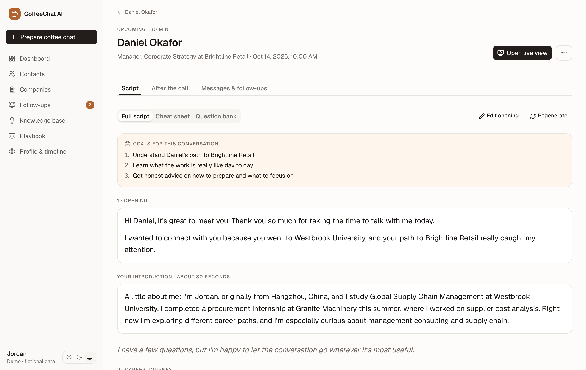
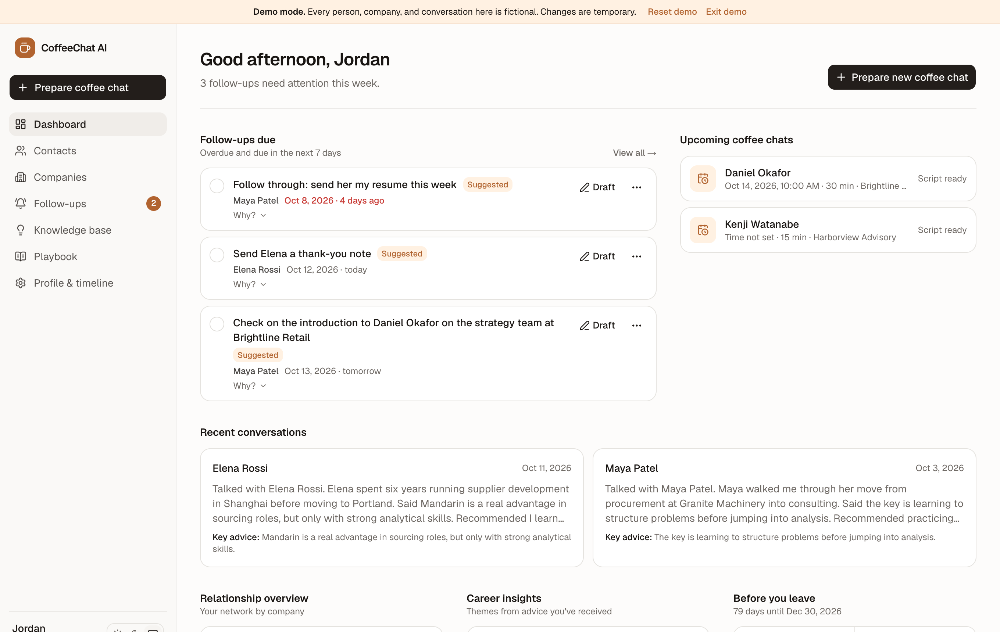
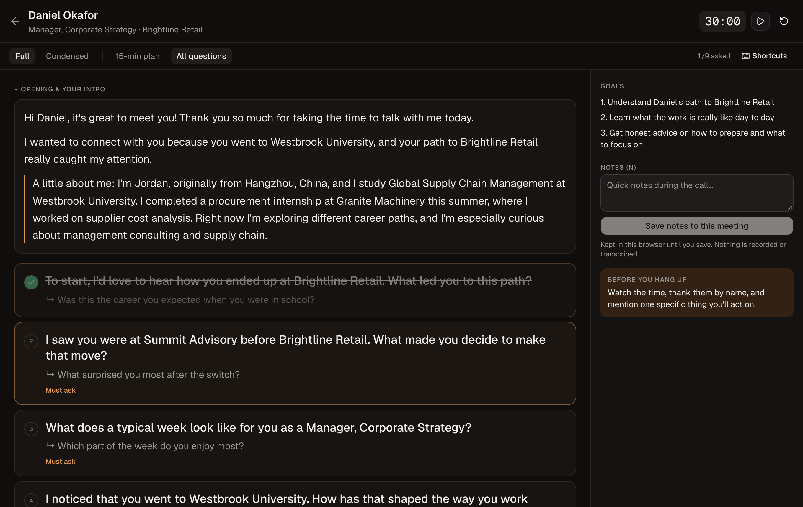
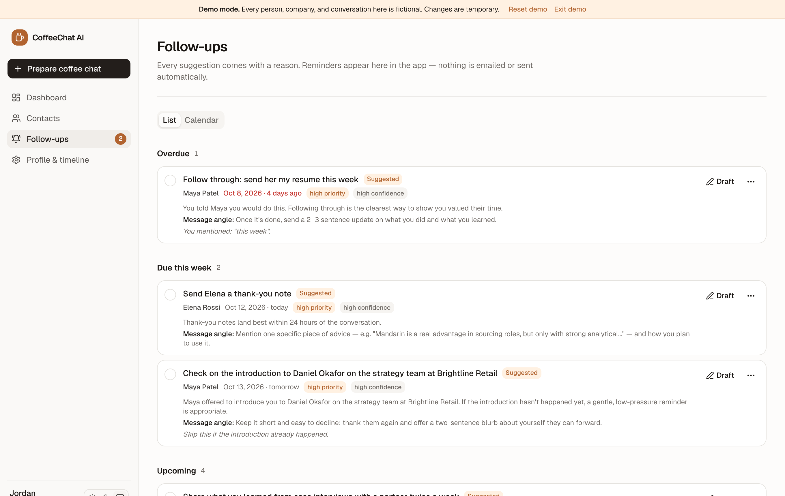
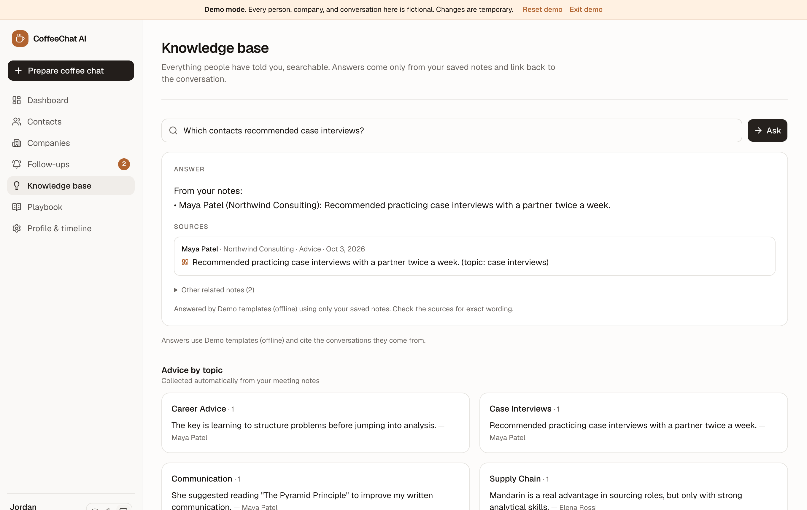
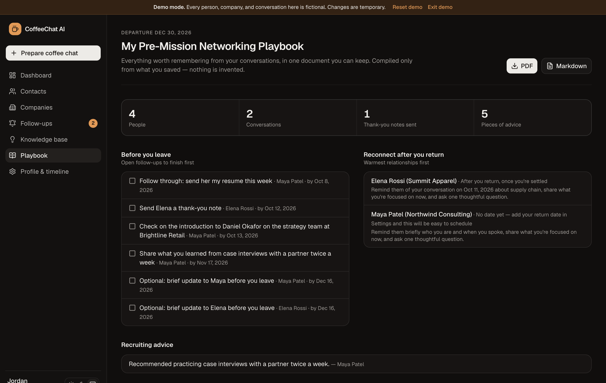
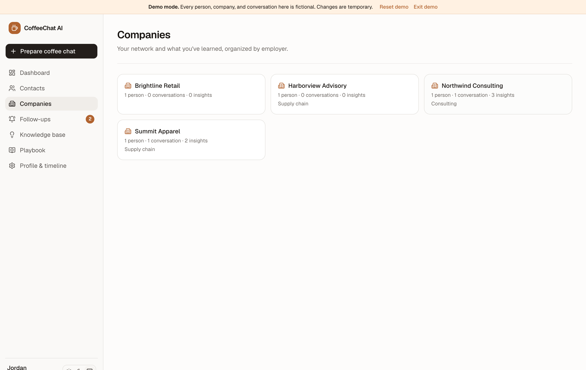

# CoffeeChat AI

**Your personal networking copilot.** Prepare for informational interviews, remember every conversation, and follow up at the right moment, so professional relationships last.

**[Try the live demo →](https://coffeechat-ai-six.vercel.app/demo)** (fictional data, no sign-up)



> Built by Toby Zheng, a Global Supply Chain Management student at BYU, as a tool I use myself and as a portfolio project. The public demo uses **only fictional people and companies**.

---

## 1. The problem

Informational interviews ("coffee chats") are one of the best ways for students to explore careers. But the usual workflow is fragmented:

1. Find someone on LinkedIn and reach out.
2. Copy their profile and the email thread into a chatbot to get questions.
3. Read from a script during the Zoom call.
4. Take notes somewhere.
5. Forget when, or whether, to follow up.

Months later, the details are gone, and so is the relationship. CoffeeChat AI handles the whole lifecycle in one place, and it's designed around one principle:

> **Help build genuine professional relationships, not just generate more networking messages.**

## 2. Features

| | |
|---|---|
| **Prepare a coffee chat** | Paste a LinkedIn profile and your email thread. The AI extracts their career history, finds *real* connections to your background, and writes a personalized script. |
| **Interview scripts** | Opening, a 20–30 second intro, career-journey, deep-dive, and career-advice questions, plus a natural close. Each question shows *why it matters*, an optional follow-up, a priority, and the **evidence quote** from their profile. Three views: **Full script**, **Cheat sheet** (15- or 30-minute plan), **Question bank**. Edit, add, delete, or regenerate any question. Your edits survive regeneration. |
| **Clean spoken introductions** | Pasted LinkedIn text is treated as source material, never read aloud. A shared normalizer extracts verified facts (school, degree, roles, employers, interests — each with its source text) and composes a 45–65 word introduction tailored to each contact. Every provider's output is validated; you can also save your own introduction, which is used word for word. |
| **Live meeting view** | A distraction-free page that fits beside Zoom: timer, large text, check-off questions, condensed mode, side notes, and keyboard shortcuts (`J/K`, `X`, `C`, `T`, `N`, `?`). No recording or transcription. |
| **Notes → insights** | Paste rough notes. The AI extracts a summary, advice, your commitments, their offers (intros), recommended resources, personal details worth remembering, and reconnect signals. **Notes are append-only.** History is never overwritten. |
| **Smart follow-ups** | A rules engine turns those facts into recommendations, each with a **date, reason, message angle, priority, and confidence**. You can accept, change the date, snooze, dismiss, or complete them. If nothing gives you a genuine reason to reconnect, it says so instead of inventing a monthly ping. |
| **Follow-up emails** | Thank-you notes, LinkedIn messages, reconnection, advice updates, and post-mission notes, in **Professional / Friendly / Brief** tones, built only from your real notes. Drafts are never sent automatically, and copying a draft never marks it sent. Only an explicit **Mark as sent** (with confirmation) does. |
| **Relationship memory** | Every contact has a timeline: added, outreach, reply, meeting, thank-you sent, upcoming follow-ups. Search covers names, companies, roles, tags, and meeting notes. |
| **Timeline-aware** | Set an upcoming commitment, such as a two-year service mission. Reminders are moved out of that window, an optional pre-departure note is suggested only for relationships with substance, and **a return date is never assumed**. You choose whether it's ever mentioned in scripts. |
| **Knowledge base** | Ask your own notes: *"What have consultants told me about recruiting?"*, *"Who have I spoken with at Deloitte?"*. Retrieval ranks your saved advice, notes, summaries, and contacts; the AI answers **only** from those snippets and every answer links back to the conversation it came from. Invented citations are discarded. Advice is also browsable by topic. |
| **Import profiles** | Upload LinkedIn's "Save to PDF" export (text is extracted on the server, no AI needed) or a profile screenshot (read by Claude). You review the text before anything is saved. Files are identified by their bytes, not their names. |
| **Company pages** | Everyone you know at a company, including people who *used to* work there, what they told you, open follow-ups, and your own research notes. |
| **Networking playbook** | *My Pre-Mission Networking Playbook*: open items to finish before you leave, who to reconnect with afterwards (warmest first) and how, recruiting advice, insights by theme, and a page per person. Compiled directly from your records, with **no AI**, so nothing is invented. Download as **PDF** or **Markdown**. |
| **Dashboard** | Upcoming chats, follow-ups due, recent conversations, your network by company and industry, career-insight themes, and progress before your departure date. |
| **Public demo** | `/demo` opens an isolated workspace seeded with fictional data. No sign-up required. |

| Dashboard | Live view | Follow-ups |
|---|---|---|
|  |  |  |
| **Knowledge base** | **Playbook** | **Company** |
|  |  |  |

## 3. Technology

| Layer | Choice |
|---|---|
| Framework | **Next.js 16** (App Router, Server Components, Server Actions, Cache Components) |
| Language | **TypeScript** (strict) |
| UI | **Tailwind CSS v4**, **shadcn/ui** (Base UI), **Lucide** icons, light & dark themes |
| Database & auth | **Supabase** Postgres + Auth (magic link) with **Row Level Security** |
| AI | **Anthropic Claude** (`claude-opus-5-5`) via the official SDK, structured outputs validated with **Zod** |
| Tests | **Vitest** (unit, workflow, and real-Postgres RLS tests via **PGlite**), **Playwright** (browser E2E) |
| CI / hosting | **GitHub Actions**, **Vercel** |

## 4. AI architecture

```
 pasted LinkedIn / email / notes (UNTRUSTED)
            │
            ▼
 ┌─────────────────────┐   fenced in <untrusted_*> tags, length-capped,
 │  Prompt builders    │   fake tags stripped; system prompt: "data, never instructions"
 │  src/lib/ai/tasks   │
 └─────────┬───────────┘
           ▼
 ┌─────────────────────┐   Claude Opus 5.5 · structured outputs (JSON schema from Zod)
 │  AIProvider         │   or offline MockProvider (tests, demo, no-key dev)
 └─────────┬───────────┘
           ▼
 ┌─────────────────────┐   Zod re-validation → grounding: every evidence quote, employer,
 │  Grounding          │   piece of advice, and resource must trace back to text you pasted;
 │  src/lib/ai/        │   anything that doesn't is removed (anti-fabrication)
 └─────────┬───────────┘
           ▼
 ┌─────────────────────┐   AI only EXTRACTS facts (offers, promises, resources, signals).
 │  Follow-up engine   │   Plain, unit-tested rules decide dates, priority, confidence,
 │  src/lib/domain/    │   mission-window shifts, spacing, and dedupe.
 └─────────────────────┘
```

Key decisions:

- **Every AI feature is a "task"** (input type + Zod schema + prompt). Providers just run tasks, so swapping models or testing offline is trivial.
- **The AI never decides when to follow up.** Timing rules live in `followup-engine.ts`, where they're explainable and have 17 unit tests.
- **Server-side only.** The Anthropic key never reaches the browser (`server-only` makes a client import a build error).
- **Usage limits.** Real AI calls are counted per user per day (atomic Postgres function). The offline templates aren't counted.
- **Refusal fallback** is enabled server-side, and errors are mapped to friendly, typed `AIError`s. If the AI fails, the data you pasted is still saved and you can retry.

More detail: [docs/ARCHITECTURE.md](docs/ARCHITECTURE.md).

## 5. Running it locally

Requirements: Node.js 22+ (24 recommended).

```bash
npm install
```

```bash
cp .env.example .env.local
```

Set `LOCAL_PASSCODE` and `SESSION_SECRET` in `.env.local`, then:

```bash
npm run dev
```

Open <http://localhost:3000>, then either **Try the demo** or **Sign in** with your passcode.

- **Local mode** needs no accounts. Data is stored in `.data/local-db.json`, which is git-ignored.
- Without `ANTHROPIC_API_KEY` the app uses offline templates (clearly labelled in the UI). Add a key to `.env.local` to use Claude.

Useful scripts:

| Command | What it does |
|---|---|
| `npm run check` | Typecheck + lint + unit/database tests |
| `npm run test:e2e` | Playwright browser tests (uses an isolated data file) |
| `SCREENSHOTS=1 npx playwright test e2e/screenshots.spec.ts` | Regenerates `docs/screenshots/` from the demo |

## 6. Deployment

Production runs on **Vercel + Supabase**. Step-by-step guide: [docs/DEPLOYMENT.md](docs/DEPLOYMENT.md). In short:

1. Create a Supabase project and run `supabase/migrations/*.sql`.
2. Import the GitHub repo into Vercel and set the environment variables from `.env.example`. **`ALLOWED_EMAILS` is required**, so only you can sign in.
3. Add the Vercel URL to Supabase Auth redirect URLs.

## 7. Privacy & security

- **Your data is yours.** Every private table has a `user_id`, and **Row Level Security** limits every query to `auth.uid()`. Child tables use **composite foreign keys** `(parent_id, user_id)`, so a row can't point at another user's record even if someone guesses a UUID. The app *also* filters by `user_id` in every query (defense in depth). This is all verified by tests that run the real migration in Postgres.
- **Exports and imports are private.** Playbook downloads require a signed-in session, and uploaded files are read in memory and never stored.
- **The demo is isolated by construction.** Demo workspaces live in memory and the demo code has no database client at all, so it *cannot* read real data. A unit test asserts the demo modules don't import storage or auth, and an E2E test checks that demo data never reaches the private store.
- **Pasted text is untrusted.** Prompt-injection defenses: fenced inputs, tag stripping, a strict system prompt, schema-constrained outputs, and grounding checks.
- **No scraping.** LinkedIn URLs are stored for reference only. You paste what you can see, and the app never logs in, crawls, or bypasses LinkedIn's restrictions.
- **Nothing is sent for you.** No automatic emails. "Mark as sent" is explicit and confirmed.
- **No secrets in git.** `.env*` (except `.env.example`) and `.data/` are git-ignored. Server Actions authenticate on every call and validate all input with Zod.

## 8. Testing

| Suite | What it covers |
|---|---|
| `tests/db/rls.test.ts` | Runs the real Supabase migration in PGlite: RLS isolation, cross-user insert/update/delete blocked, composite-FK protection, anon lockout, follow-up dedupe, atomic AI usage counter, cascades |
| `tests/unit/workflow.test.ts` | Full workflow: contact → profile → script → edit survives regeneration → notes → follow-ups → email → mark sent → history; notes never overwritten; data kept when AI fails |
| `tests/unit/followup-engine.test.ts` | Every follow-up rule, mission window, spacing, dedupe, dashboard buckets |
| `tests/unit/ai.test.ts` | Prompt-injection fencing, grounding, schema validation, Claude provider with a mocked API (refusal, truncation, bad output), usage limits |
| `tests/unit/ownership.test.ts` | No service can read or modify another user's records |
| `tests/unit/milestone2.test.ts` | Knowledge retrieval and citations (and that invented citations are dropped), no AI call when notes don't cover a question, per-user search; playbook contains only recorded facts; real Markdown and PDF output; PDF/screenshot import and file sniffing; company pages |
| `tests/unit/demo.test.ts`, `auth.test.ts` | Demo isolation and fictional seed; session token tampering and expiry |
| `e2e/workflow.spec.ts` | Real browser: sign-in protection, full coffee-chat flow, demo ↔ private isolation |
| `e2e/milestone2.spec.ts` | Real browser: knowledge base Q&A with sources, company research notes, playbook PDF/Markdown downloads (and that they're private), LinkedIn PDF import |

All AI calls in automated tests are mocked. No test spends API credits.

## 9. Roadmap

Done: Phase 1 (core workflow) and Phase 2 (relationship intelligence: timeline, follow-up management, search, knowledge base, live companion, company pages, PDF import), plus the playbook export, public demo, and CI from Phase 3.

Next:

- Optional Claude API key in production (the private app currently runs on the free offline templates).
- AI conversation practice: rehearse a coffee chat with a simulated version of the contact, built only from their profile.
- Optional email reminders (the follow-up model is channel-agnostic; this needs a scheduled job such as Vercel Cron).
- Postgres full-text search for the knowledge base at larger scale (the `tsvector` indexes already exist).
- A static shell with Suspense streaming for faster navigation under Cache Components.

## 10. License

The recommended license is **MIT** (see [docs/LICENSE-RECOMMENDATION.md](docs/LICENSE-RECOMMENDATION.md)). It's not applied yet; the author should choose before publishing.
